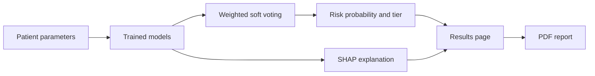

# CardioXAI


An explainable machine learning application for heart disease risk assessment. CardioXAI combines four classifiers in a weighted soft-voting ensemble, explains each prediction with SHAP, and generates a downloadable PDF report through a Streamlit interface.

> **Disclaimer:** This project is for educational and research purposes only. It is not a medical device and is not a substitute for professional diagnosis, advice, or treatment.

## Overview

CardioXAI takes 13 clinical parameters for a patient, estimates the probability of heart disease, and places the patient in one of four risk tiers. SHAP values show how each parameter contributed to the prediction, and separate pages present model performance and the underlying dataset.

## Key Features

- Weighted soft-voting ensemble of Random Forest, TabPFN, XGBoost, and LightGBM
- Patient-level explanations using SHAP
- Four-tier risk stratification with a recommendation for each tier
- PDF report generation with ReportLab
- Model performance page with evaluation charts and metrics
- Dataset explorer with distribution and correlation views
- Automatic model training on first launch

## Application Pages

| Page | Purpose |
| --- | --- |
| Risk Assessment | Enter patient parameters and view the prediction and SHAP explanation |
| Model Performance | Compare model metrics and evaluation charts |
| Dataset Explorer | Explore feature distributions, correlations, and class balance |
| About | Project summary and methodology |

## Technology Stack

| Component | Technology |
| --- | --- |
| Interface | Streamlit, Plotly |
| Models | scikit-learn, XGBoost, LightGBM, TabPFN |
| Explainability | SHAP |
| Reporting | ReportLab |
| Data | pandas, NumPy, Hugging Face Datasets |
| Persistence | joblib |

## Architecture and Workflow



## Project Structure

```text
CardioXAI/
├── app.py                     Streamlit entry point
├── data/
│   ├── loader.py              Dataset loading with CSV fallback
│   └── cleveland_heart.csv    Bundled dataset
├── models/
│   ├── train.py               Model training and evaluation
│   ├── ensemble.py            Weighted ensemble
│   └── saved/                 Saved metrics and trained models
├── explainability/
│   └── shap_explainer.py      SHAP explanations and charts
├── reports/
│   └── pdf_generator.py       PDF report generation
├── utils/
│   └── ui_helpers.py          Interface styling and components
├── assets/
│   └── logo.svg
└── requirements.txt
```

## Installation and Setup

```bash
git clone https://github.com/Partha-Shankar/CardioXAI.git
cd CardioXAI
python -m venv venv
```

Activate the virtual environment:

```bash
source venv/bin/activate      # Linux and macOS
venv\Scripts\activate         # Windows
```

Install the dependencies:

```bash
pip install -r requirements.txt
```

`requirements.txt` pins NumPy below version 2, so use a Python version that has compatible NumPy wheels.

## Usage

```bash
streamlit run app.py
```

The application opens at `http://localhost:8501`. Trained model files are not stored in the repository, so the models are trained automatically on first launch.

## Technical Implementation

### Dataset

The loader first requests the `imodels/heart_disease` dataset from Hugging Face and falls back to the bundled `data/cleveland_heart.csv`, which contains 274 records with 13 features and a binary target.

### Models

| Model | Key Parameters |
| --- | --- |
| Random Forest | 200 estimators, maximum depth 8 |
| XGBoost | 200 estimators, maximum depth 5, learning rate 0.05 |
| LightGBM | 200 estimators, maximum depth 6, learning rate 0.05 |
| TabPFN | Pretrained tabular classifier |

### Evaluation

These results come from `models/saved/metrics.json`. Accuracy, precision, recall, and F1 are measured on a held-out test split. AUC-ROC is the mean of 5-fold cross-validation on the training split. The dataset is small, so these figures are indicative rather than clinically validated.

| Model | Accuracy | Precision | Recall | F1 | AUC-ROC |
| --- | --- | --- | --- | --- | --- |
| TabPFN | 0.927 | 0.903 | 0.966 | 0.933 | 0.958 |
| Random Forest | 0.909 | 0.875 | 0.966 | 0.918 | 0.962 |
| LightGBM | 0.909 | 0.929 | 0.897 | 0.912 | 0.957 |
| XGBoost | 0.891 | 0.897 | 0.897 | 0.897 | 0.954 |

### Risk Tiers

| Tier | Probability | Recommendation Shown |
| --- | --- | --- |
| Low | Below 25% | Routine annual screening |
| Moderate | 25% to 50% | Cardiologist consultation within 3 months |
| High | 50% to 75% | Urgent referral and stress test |
| Critical | 75% and above | Immediate medical evaluation |

## Future Scope

- Validation on larger and external clinical datasets
- Calibration analysis of the predicted probabilities
- Automated tests for the training and prediction pipelines
